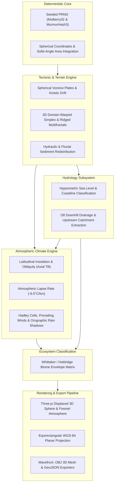

<div align="center">

# 🪐 WORLD ENGINE
### CREATE WORLDS. DEFINE THEIR RULES. EXPLORE THE UNKNOWN.

**Procedural Planet Generation & Interactive Environmental Simulation Platform**

[](LICENSE)
[](https://www.typescriptlang.org/)
[](https://react.dev/)
[](https://threejs.org/)
[](https://vitejs.dev/)
[](src/tests/scientific-validation.ts)

<br/>

[Live Demo](#live-demo-deployment) • [Key Features](#key-features) • [Scientific Models](#scientific-simulation-models) • [Visualization Modes](#scientific-visualization-modes) • [Quick Start](#quick-start) • [Export & OBJ](#3d-mesh-and-data-export)

<br/>

</div>

---

## 🌟 Overview

**WORLD ENGINE** is a procedural planet creation and interactive scientific simulation platform. Rather than generating a simple random terrain mesh, WORLD ENGINE maintains a strongly-typed planetary data model where spherical geology, continental tectonics, hydrological drainage networks, thermodynamic atmospheric circulation, and ecological biomes are coupled deterministically.

Built with **React**, **TypeScript**, **Three.js**, and **Tailwind CSS**, it runs entirely client-side with 60 FPS WebGL rendering, real-time geographic raycasting, and zero external server dependencies.

---

## 📐 System Architecture



---

## ⚡ Key Features

- **Deterministic & Reproducible**: 100% reproducible planetary generation driven by 32-bit seeds and independent sub-streams for terrain, climate, and hydrology.
- **3D Physical Relief Extrusion**: Spherical geometry vertices are physically displaced outward along mountain peaks and recessed into ocean trenches.
- **Interactive Multi-View Workspace**:
  - `3D Globe Explorer`: 3D WebGL sphere with Fresnel outer rim glow, dynamic day/night sunlight, and procedural clouds.
  - `2D Planar Map`: Full Equirectangular WGS-84 projection with interactive graticule, gold Equator, and cyan Prime Meridian.
  - `Scientific Laboratories`: Hypsometric elevation frequency curve, latitudinal climate gradients, and terrestrial biome area rankings.
  - `Planet Comparison Lab`: Side-by-side benchmarking with real-time Net Delta calculations.
- **Real-Time Geographic Raycasting**: Hover or click anywhere on the globe to query exact latitude, longitude, physical elevation in meters, slope angle, local mean temperature, precipitation, and biome definition.
- **Live Sea-Level Slider**: Modify sea level to observe live coastal transgression/regression and real-time spherical land/water coverage updates.
- **10 Scientific Visualization Modes**: Photorealistic true-color, hypsometric elevation, thermal scale, annual precipitation, biomes, aridity index, slope relief, tectonics, bathymetric depth, and elevation contours.
- **Export Pipeline**: Download project configuration JSON, 2D equirectangular heightmap PNGs, printable scientific HTML dossiers, or 3D Wavefront `.OBJ` meshes ready for Blender, Maya, Unreal Engine, and 3D printing.

---

## 🔬 Scientific Simulation Models

### 1. Geodesic & Spherical Coordinate Conventions
Cartesian coordinates $(x, y, z)$ map to spherical latitude $\phi \in [-90^\circ, +90^\circ]$ and longitude $\lambda \in [-180^\circ, +180^\circ]$ without polar singularities:
$$\begin{aligned}
x &= \cos(\phi) \sin(\lambda) \\
y &= \sin(\phi) \quad \text{(Rotational Axis)} \\
z &= \cos(\phi) \cos(\lambda)
\end{aligned}$$
Surface area calculations use exact spherical solid angles:
$$\Delta \Omega = |\lambda_2 - \lambda_1| \cdot |\sin(\phi_2) - \sin(\phi_1)| \quad \text{steradians}$$

### 2. Climate & Thermal Gradient
Planetary temperature considers latitudinal solar insolation, seasonal swings from axial tilt $\theta_{\text{tilt}}$, continental heat moderation, and tropospheric lapse-rate cooling:
$$T(\phi, h) = T_{\text{global}} + \Delta T_{\text{solar}} \cos^{0.85}(\phi) - \Gamma \cdot h_{\text{km}} + \Delta T_{\text{greenhouse}}$$
where $\Gamma = 6.5^\circ\text{C} / \text{km}$ is the standard atmospheric lapse rate.

### 3. Atmospheric Moisture & Orographic Rain Shadows
Warm air holds exponentially more moisture (Clausius-Clapeyron relation). Prevailing zonal winds (Trade Winds and Westerlies) carry moisture against mountain barriers:
- **Windward Slopes**: Air rises, cools adiabatically, and condenses into intense precipitation.
- **Leeward Slopes**: Descending dry air creates an arid rain shadow on the opposite side of mountain ranges.

### 4. Hydrological D8 Drainage
Surface runoff follows the steepest downhill gradient to its neighboring cells:
$$S_{i} = \frac{h_{\text{cell}} - h_{\text{neighbor}}}{d_{i}}$$
Upstream catchment accumulates downhill, extracting dendritic river channels where accumulated drainage exceeds the river formation threshold.

---

## 🎨 Scientific Visualization Modes

| Mode | Colormap Ramp | Scientific Data Represented |
| :--- | :--- | :--- |
| **Natural** | Biome True Color | Photorealistic biomes, alpine snowcaps, bathymetric shelf depths, and day/night sunlight terminator. |
| **Elevation** | Bathymetry $\rightarrow$ Hypsometric | Deep ocean indigo ($-11\text{km}$) $\rightarrow$ cyan shelf $\rightarrow$ lowland green $\rightarrow$ highland brown $\rightarrow$ peak white ($+8.8\text{km}$). |
| **Thermal** | Diverging Scientific | $-45^\circ\text{C}$ (violet/indigo) $\rightarrow$ $0^\circ\text{C}$ (cyan/green) $\rightarrow$ $+45^\circ\text{C}$ (yellow/crimson). |
| **Rainfall** | Arid Ochre $\rightarrow$ Storm Navy | Annual rainfall in mm/year ($0\text{ mm}$ desert sand $\rightarrow$ $3,500+\text{ mm}$ storm blue). |
| **Biomes** | Discrete Categorical | 16 discrete Whittaker/Holdridge ecological classification biomes. |
| **Moisture** | Aridity $\rightarrow$ Perhumid | Ratio of precipitation to potential evapotranspiration (PET index $[0, 1]$). |
| **Slope** | Gradient Relief | Terrain slope angle from $0^\circ$ flat plains (slate) to $60^\circ+$ cliffs (bright red). |
| **Tectonics** | Lithospheric Plate ID | Discrete colored tectonic plates with highlighted collision and rift boundaries. |
| **Bathymetry** | Marine Depth Zones | Shallow sunlit shelves ($0$ to $-400\text{m}$) $\rightarrow$ bathyal zone $\rightarrow$ abyssal plains (&gt; $-6000\text{m}$). |
| **Contours** | Topographic Isolines | Isolines rendered every $600\text{m}$ on land and $1,200\text{m}$ in marine basins. |

---

## 🪐 Archetypal Planetary Presets

- **Earth-like (Terra)**: Balanced habitable terrestrial sphere with dynamic continents, deep oceans, moderate tilt ($23.44^\circ$), and river networks.
- **Ocean World (Pelagia)**: Vast global ocean dotted with volcanic island chains and submerged continental shelves.
- **Desert World (Dune)**: Hyper-arid continental super-desert with vast dune seas, canyonlands, and minimal surface water.
- **Frozen World (Cryos)**: Snowball planet with runaway glacial ice sheets, permafrost tundra, and frozen seas.
- **Archipelago World (Sirena)**: Intricate chains of coral atolls, fragmented coastlines, and shallow turquoise shelves.
- **Mountain World (Titan Peak)**: Massive continental collision belts, extreme orogeny peaks ($14,500\text{ m}$), and steep gorges.
- **Volcanic World (Ignis)**: Basaltic shield volcanoes, dense greenhouse atmosphere, hot geothermal basins, and sulfurous terrain.
- **Exoplanet (Aethelgard)**: Alien biosphere with violet vegetation, high axial tilt ($41^\circ$), and labyrinthine terrain.

---

## 🧪 Scientific Validation Suite

WORLD ENGINE includes an automated mathematical and scientific test suite verifying core physical laws:

```text
================================================================
WORLD ENGINE — SCIENTIFIC & MATHEMATICAL VALIDATION SUITE
================================================================

[✓ PASS] Test 1: Seed Reproducibility
       Details: Identical seeds yielded identical elevation fields and surface statistics.

[✓ PASS] Test 2: Spherical Coordinate Conversion
       Details: Tested Equator, North Pole, South Pole, and Antimeridian successfully.

[✓ PASS] Test 3: Land/Water Classification
       Details: Raising sea level reduced land from 49.5% to 10.6%; lowering increased land to 93.2%.

[✓ PASS] Test 4: Surface Coverage Solid Angle Calculation
       Details: Land + Water equals exactly 100.00% (510,064,472 km²).

[✓ PASS] Test 5: Elevation Extremes & Distribution
       Details: Min: -10,301m, Max: +8,848m, Mean: 448m.

[✓ PASS] Test 6: Slope Gradient Angle Calculation
       Details: All slopes within [0, π/2] radians; max slope is 73.5°.

[✓ PASS] Test 7: Hydrological D8 Drainage Pathways
       Details: 100.0% of flow directions strictly downhill towards coastal base levels.

[✓ PASS] Test 8: Climate Physical Relationships
       Details: Solar insolation cooled equator (20.3°C) to pole (-3.2°C); lapse rate cooling verified.

[✓ PASS] Test 9: Ecological Biome Classification Matrix
       Details: Verified tropical rainforest, glacial ice, hot desert, and ocean biome classification bounds.

[✓ PASS] Test 10: Subsystem Dependency Invalidation
       Details: Selective sea level update preserved raw terrain elevation arrays without wasteful recalculation.

================================================================
RESULTS: 10 / 10 Tests Passed (100%)
================================================================
```

---

## 🚀 Quick Start

### Prerequisites
- Node.js 18+ or 20+
- npm / pnpm / yarn

### Installation
```bash
# Clone the repository
git clone https://github.com/your-username/world-engine.git

# Navigate to project directory
cd world-engine

# Install dependencies
npm install

# Start development server
npm run dev
```

Open **`http://localhost:5173`** in your browser.

### Run Scientific Validation Tests
```bash
npm test
```

### Build for Production
```bash
npm run build
```
The optimized bundle will be created in the `dist/` directory.

---

## 🌐 Live Demo & Deployment

### Deploy to GitHub Pages (Automated)
The repository includes a GitHub Actions workflow (`.github/workflows/deploy.yml`):
1. Push this repository to GitHub.
2. In your repository settings, navigate to **Settings** $\rightarrow$ **Pages**.
3. Under **Build and deployment**, select **Source: GitHub Actions**.
4. Every push to `main` will build, test, and publish the live site to `https://<your-username>.github.io/world-engine/`.

---

## 📦 3D Mesh and Data Export

Click the **Export** button in the top bar to generate:
- **3D Wavefront Mesh (`.OBJ`)**: Displaced spherical polygon mesh with baked vertex colors for Blender, Maya, Unreal Engine, and 3D printing.
- **Heightmap & Surface PNGs**: High-resolution equirectangular raster maps.
- **Configuration JSON**: Full planetary parameters and deterministic seed metadata.
- **Scientific Dossier (HTML)**: Printable planetary report detailing physical dimensions, crustal hypsometry, and climate metrics.

---

## 📄 License

This project is licensed under the **MIT License** — see the [LICENSE](LICENSE) file for details.
